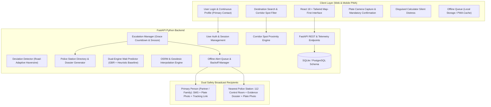

# 🛡️ HitchSafe — Safety & Intelligence Platform for Hitchhikers

**HitchSafe** is an offline-first mobile-first map platform for hitchhikers across three core journey stages:
1. **BEFORE the ride**: Search any destination to view the route and find optimal nearby hitchhiking spots along that corridor. Predict wait times using a dual-engine ML model with transparent heuristic fallback for data-sparse regions (e.g., India).
2. **DURING the ride**: Log vehicle plate (with mandatory OCR confirmation & plate photo evidence), auto-link your continuous profile & primary emergency contact, detect route deviations or unusual stops, and automatically escalate SOS alerts with grace countdowns, snooze, and disguised calculator distress mode.
3. **AFTER the ride & SAFETY NET**: If the user **has not reached the specified destination**, HitchSafe executes a simultaneous **Dual Emergency Broadcast**:
   - Dispatches an emergency alert message **with the actual photo of the vehicle number plate** to the **Primary Contact Person**.
   - Transmits an official incident dossier **with the vehicle number plate photo and last known GPS coordinates** to the **Nearest Police Station** (linked via emergency room 112 / PCR highway unit).

---

## 🏗️ Architecture Overview



---

## ⚡ Quick Start & Setup Instructions

### Prerequisites
- **Python**: 3.10+ (tested on Python 3.13)
- **Node.js**: 18+ (tested on Node v22.17)

### 1. Unified Single-Server Run (Recommended)
The frontend build is pre-compiled into `frontend/dist` and directly served by FastAPI.

```powershell
# Navigate to backend directory
cd "C:\Users\AYISHA FIDHA T V\.gemini\antigravity\scratch\hitchsafe\backend"

# Start the unified backend & web app server
python -m uvicorn app.main:app --host 0.0.0.0 --port 8000 --reload
```
Open **`http://localhost:8000`** in any browser.  
- Interactive HitchSafe Web App: **`http://localhost:8000`**
- Interactive Swagger API Documentation: **`http://localhost:8000/docs`**
- Public Zero-Install Tracking Link: **`http://localhost:8000/track/<token>`**

### 2. Frontend Development Mode (Hot Reload)
If modifying the React frontend:
```powershell
cd "C:\Users\AYISHA FIDHA T V\.gemini\antigravity\scratch\hitchsafe\frontend"
npm.cmd run dev
```
Open **`http://localhost:5173`** (Vite proxies all `/api/*` requests to port 8000).

### 3. Running Unit Tests
To run the automated test suite verifying auth, corridor spot filtering, deviation detection, alert queuing, escalation timers, police dispatch, and ML models:
```powershell
cd "C:\Users\AYISHA FIDHA T V\.gemini\antigravity\scratch\hitchsafe\backend"
python -m pytest -v
```

---

## 📋 Short Log of Engineering Decisions

| Phase | Core Decision | Rationale |
|---|---|---|
| **Phase 1: Scaffolding** | SQLite local database with auto-migration | Zero-setup portability for hackathon MVP; seamless migration path to PostgreSQL in production. |
| **Phase 2: Spot Data** | Hitchmap seed + Indian highway spots (NH 44, NH 48) | Hitchmap coverage in India is historically sparse; curated entry ramps and toll laybys seed cold-start regions. |
| **Phase 3: Continuous Profile & Auth** | User login / sign up + continuous primary contact | Saves user identity and primary contact so the traveler never has to re-type emergency phone numbers before hopping into a car. |
| **Phase 4: Destination Corridor Filter** | Proximity filter along expected polyline towards destination | Hitchhikers need spots heading in the direction of their journey, not just raw circular radius around origin. |
| **Phase 5: Dual Safety Broadcast with Plate Photo** | Simultaneous dispatch to Primary Contact AND Nearest Police Station | Fulfills real-world law enforcement requirements: police need the vehicle plate image and last known coordinates for highway patrol intercepts; primary contact needs immediate awareness and live tracking. |
| **Phase 6: Wait-Time ML** | Heuristic Baseline fallback when $N < 10$ regional samples | Avoids ML overfitting in data-sparse regions like rural India. Shows explicit confidence levels and bus alternatives. |

---

## 🗺️ Data Sources & License Attributions

- **Hitchmap Community Data**:
  - Hitchhiking spot locations, pull-off observations, and wait times are seeded from open crowdsourced Hitchmap records.
  - License: **Open Database License (ODbL) / Creative Commons Attribution-ShareAlike 4.0 International (CC-BY-SA 4.0)**.
  - Attribution is rendered directly on the map footer and inside spot information cards.
  - Reference: [Hitchmap.com](https://hitchmap.com).
- **OpenStreetMap (OSM)**:
  - Map tiles and road geometry provided by OpenStreetMap contributors under the **Open Database License (ODbL)**.
- **Routing**:
  - OSRM (Open Source Routing Machine) routing engine with geodesic interpolation fallback for offline operation.

---

## 🛡️ Explicit Solutions to Known Limitations

### 1. Intermittent Signal & Low-Coverage Corridors
- **Offline Queue**: Telemetry pings and emergency alerts are persisted in a local queue (`offline_queue`) when disconnected.
- **Exponential Backoff**: When network restores, the sync worker drains the queue with progressive delay retry ($2^{\text{retry}}$ seconds).
- **UI Transparency**: Real-time status banner highlights `"Last Synced: X"` and `"N alerts pending reconnect"`.
- **Pre-Caching**: Expected route polyline and map tiles are cached locally upon ride creation.

### 2. Wait-Time Accuracy in Sparse Regions (India & Developing Corridors)
- **Transparent Heuristic Baseline**: If historical regional observations $N < 10$, the app automatically switches to a transparent rule-based physics baseline (factoring road type, hour, day, amenities, and traffic).
- **Confidence Calibration**: Displays uncertainty ranges (e.g., `14 - 24 mins`) and explicit confidence ratings (`HIGH`, `MEDIUM`, `LOW`) rather than falsely precise single numbers.
- **Contribute Data Loop**: Post-ride feedback updates rolling regional averages and incrementally trains the gradient-boosted regressor.
- **Bus Recommendation**: Computes a dynamic transit threshold (e.g., *"Consider bus after 35 minutes"*).

### 3. Location Privacy, Stalking & Misuse Risks
- **Per-Trip Opt-In**: Location sharing is strictly opt-in per trip session and expires immediately upon safe arrival.
- **Tokenized Links**: Zero-install live-tracking links utilize random UUIDv4 hex tokens with no public index.
- **No Public Histories**: Trusted contacts can only view the active journey; no public travel dossiers or user tracking archives exist.
- **Delete-My-Data Option**: Settings screen provides a single-click purge that permanently wipes GPS pings, photos, and personal information from local and server storage.

### 4. False Alarms & Contact Desensitization
- **Grace Countdown**: Displays a prominent 45-second "Are you okay?" prompt before dispatching escalations.
- **Snooze Option**: Allows up to two $+120$s grace period extensions for fuel stops, traffic delays, or tire checks.
- **Noise Smoothing**: Averages consecutive GPS pings to eliminate GPS drift glitches.

### 5. Battery Drain from Continuous GPS
- **Adaptive Sampling Profile**:
  - *On-Track Normal*: 30s sampling interval ($\approx 1.8\%$ battery drain/hour).
  - *Suspected Drift / Long Stop*: 5s sampling interval ($\approx 4.2\%$ battery drain/hour).
- **Settings Transparency**: Displays live battery profile and estimated drain in the settings panel.

### 6. Plate OCR Misreadings
- **Mandatory User Confirmation**: Plate OCR scans auto-open an editable confirmation dialog.
- **Local & Evidence Photo Storage**: The raw plate photograph is cached on-device with the trip record for emergency transmission.

### 7. Abuse & Platform Spam Prevention
- **Contact-Centric Architecture**: HitchSafe operates through trusted personal contacts rather than open public social feeds.
- **Spot Flagging**: Inaccurate or unsafe spots can be reported and flagged with reason codes.

### 8. Regional Norms & Highway Regulations
- **Regional Guidance Screen**: Detailed legal summaries for India (Motor Vehicles Act & NHAI expressway pedestrian bans), Europe (Autobahn vs Péage), and the Americas.

### 9. Safety Reality & Honest Framing
- **Prominent Disclaimer**: Exhibited at onboarding and in headers. Framed strictly as an assistive risk-reduction aid, never claiming it guarantees safety or prevents crime.

### 10. External Provider Cost & Rate Limits
- **Provider Abstraction**: SMS, push alerts, and police dispatch run behind an abstract `BaseAlertProvider` interface.
- **Mock Alert Provider**: Defaults to an interactive in-memory and database mock provider for zero-cost hackathon evaluation.

---

## 🎬 2-Minute Hackathon Demo Script (With Missed Destination & Police Dispatch)

1. **User Login & Continuous Profile**:
   - Open **`http://localhost:8000`**.
   - Tap **Login / Sign Up** in the header $\to$ Click **Quick 1-Tap Demo Login (Aarav & Priya)**.
   - Profile avatar appears showing **Aarav Nair (Primary Contact: Priya Nair)**.
2. **Destination Search & Corridor Spots**:
   - On the full-screen map, click quick chip **Kempegowda Airport (NH 44 North)**.
   - The route line is drawn to the airport, and nearby spots along NH 44 corridor are highlighted.
   - Click on the **Hebbal Flyover (NH 44 North)** marker $\to$ View the spot card, wait-time prediction (`14 - 24 min`), and click **Start Ride From This Spot**.
3. **Plate Photo Capture & Personal Phone Setup**:
   - The ride logger opens pre-filled with traveler name and destination.
   - Scan the vehicle plate `KA 04 MB 7821` with the attached plate photograph.
   - **Demo Tip**: Enter **YOUR OWN mobile number** in the primary contact field so the SOS alert is sent to your phone!
   - Tap **Start Monitored Ride**.
4. **Simulate Missed Destination SOS & Real Phone Alert**:
   - In the Live Ride monitor (or Demo Simulator), tap **🚨 Simulate Missed Destination**.
   - The **Dual Safety Escalation Modal** immediately appears showcasing:
     - **Tab 1: Primary Person Alert**: Displays the alert with the **photo of the vehicle number plate**, last known GPS pin, and tracking link.
     - **Live Phone Dispatch**: Click **📱 Send Real SMS** or **🟢 Send WhatsApp** to trigger the SOS message and vehicle photo link directly to your personal phone!
     - **Tab 2: Nearest Police Station Dispatch**: Transmits the emergency dossier to **Hebbal Law & Highway Patrol Police Station (NH 44 North)** with the **vehicle plate photo evidence tag**, FIR case number, and assigned PCR intercept unit!
5. **Log User Experience & View Community Logs**:
   - Click the **Experiences** tab in the top navigation bar.
   - Fill in your origin location, destination, where you got the ride (pickup spot), and how much you had to wait there (e.g. 15 mins).
   - Publish to see it appear in the community feed and update the spot's live dataset!
6. **Deploy to Vercel**:
   - HitchSafe includes `vercel.json` and `api/index.py` for serverless deployment.
   - Run `npx vercel --prod` to deploy live to the web in under 60 seconds (see [`DEPLOY_VERCEL.md`](file:///C:/Users/AYISHA%20FIDHA%20T%20V/.gemini/antigravity/scratch/hitchsafe/DEPLOY_VERCEL.md)).

